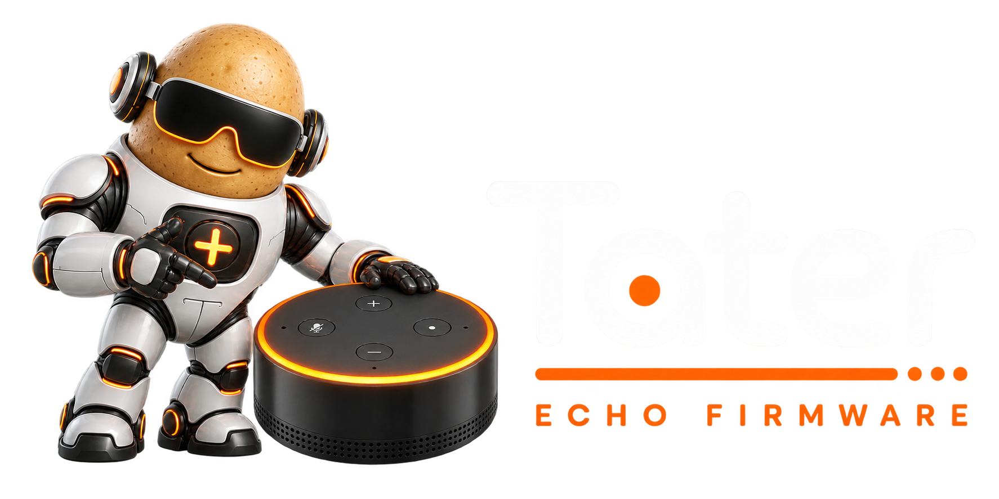

<p align="center">
  
</p>

<p align="center">
  <a href="https://taterassistant.com"></a>
</p>

<p align="center">
  <a href="https://github.com/TaterTotterson/Tater-Echo-Firmware/actions/workflows/ci.yml"></a>
  <a href="https://github.com/TaterTotterson/Tater-Echo-Firmware/releases"></a>
  <a href="LICENSE"></a>
</p>

Tater Echo Firmware turns supported, unlocked Amazon Echo hardware into native
Tater voice satellites. Wake detection, audio processing, playback, displays,
controls, Bluetooth, and OTA updates run directly on the Echo. Home Assistant
and a separate Echo controller are not required.

## Supported devices

Only the exact generations and codenames below are supported. Do not use an
installer on a similar-looking Echo from another generation.

| Device | Target | Required unlock | Installed system | Factory | OTA |
|---|---|---|---|---:|---:|
| Echo Dot 2nd Generation (2016), RS03QR | `biscuit` | amonet-biscuit v2.0.0 | Tater Linux | Yes | Yes |
| Echo 2nd Generation (2017), XC56PY | `radar` | amonet-radar v1.0.0 | Tater Linux | Yes | Yes |
| Echo Show 5 1st Generation (2019), H23K37 | `checkers` | amonet-checkers v2.0.1+ | Tater Linux | Yes | Yes |
| Echo Show 8 1st Generation (2019), C7H6N3 | `crown` | amonet-crown v2.0.1+ | Tater Linux | Yes | Yes |
| Echo Show 8 2nd Generation (2021), A8H3N2 | `athena` | saiyaku-athena, Fire OS 7080 | Tater Linux | Yes | Yes |
| Echo Spot 1st Generation (2017), VN94DQ | `rook` | amonet-rook v2.0.0 | Tater Linux | Yes | Yes |

Target metadata used by Tater and the release builds lives in
[`targets/targets.json`](targets/targets.json).

> [!IMPORTANT]
> **v4.0.0 requires one USB/TWRP factory installation on every supported Echo
> target.** Any existing installation earlier than v4.0.0 cannot cross this platform boundary
> through OTA. Use the factory archive matching the exact device; the installer
> preserves verified Tater pairing, Wi-Fi, SSH, and satellite settings by
> default, or pass `--factory-reset` for a clean start. After v4.0.0 is installed,
> Tater can deliver compatible application and root-system updates through its
> verified A/B OTA flow with automatic rollback.

> [!NOTE]
> On a pre-v4 Biscuit or Radar, boot the satellite normally and connect it
> directly by USB. Run `python3 to_twrp.py` from the extracted v4 factory archive
> (`py -3 to_twrp.py` on Windows), wait for TWRP to start, and then continue
> with the normal factory installer. You do not need to hold Volume Up or enter
> Tater Recovery first. Do not use `--repair` for this upgrade; repair mode only
> fixes an existing Tater system slot.

> [!IMPORTANT]
> Athena's installer validates the display panel and unit-specific speaker
> tuning before writing either partition. Keep the private Fire OS backup it
> creates; it is required for rollback and contains that unit's original
> speaker tuning. See [`docs/athena.md`](docs/athena.md) for the supported
> hardware contract and regression checklist.

## Features

- Sat Chat audio and video calls from satellite to satellite and from Tater on
  a phone to a satellite. Checkers, Crown, Athena, and Rook support audio and video;
  Biscuit and Radar participate in audio calls.
- On-device microWakeWord, openWakeWord, or NanoWakeWord CNN/GRU detection,
  including MWW + OWW and MWW + NWW confirmation modes, built-in or custom
  wake bundles, live sensitivity, and room-environment profiles managed from
  Tater.
- Hardware-appropriate microphone processing, echo cancellation, and
  beamforming: seven microphones on Biscuit and Radar, two on Checkers, and
  four on Crown, Athena, and Rook.
- Continued conversation, playback barge-in, room intercom, announcements,
  wake sounds, mute, volume, and wake-audio training samples.
- Per-satellite Do Not Disturb with an immediate toggle and daily local-time
  schedule. DND stops music, announcements, wake sounds, and other remote
  playback while leaving wake detection and safety-critical timers/alarms active.
- Local timers and alarms with spoken `Stop`, physical action-button controls,
  and on-screen Stop controls on Checkers, Crown, Athena, and Rook.
- Sendspin multi-room and stereo-pair playback with synchronized PCM/FLAC,
  native TTS overlays, audio scenes, music ducking, and persistent output
  channel selection.
- Native Checkers, Crown, Athena, and Rook photo dashboards with bundled landscapes or
  user wallpapers, weather and room sensors, music, timers, Awareness
  notifications, configurable themes, and live assistant status.
- Touch access on Checkers, Crown, Athena, and Rook to Sat Chat, integration-backed
  thermostat controls, and Room Vision camera and doorbell feeds. Integration
  HLS and UniFi Protect RTSPS use the pinned FFmpeg decoder, Tater Echo cameras
  use the native MJPEG relay, and all retain automatic JPEG fallback and optional
  push-to-talk audio.
- Tater-controlled Biscuit and Radar LED animations for wake, voice, music,
  volume, mute, timer, setup, connection, and update states.
- Passive BLE advertisement forwarding for room-level presence, plus secure
  active BLE GATT connections for services such as Meshtastic Core with PIN
  pairing, persistent bonds, notifications, and unpairing.
- Captive-portal Wi-Fi and Tater pairing, followed by verified A/B OTA updates
  with automatic rollback.

## USB Ethernet adapters

The hardware-tested reference adapter is the powered
[UCTRONICS B0B9ZLVGJ4](https://www.amazon.com/dp/B0B9ZLVGJ4), using a Realtek
RTL8152 controller (`0bda:8152`, Linux `r8152`). This exact adapter passed the
documented Ethernet, Wi-Fi fallback, SSH, update, reboot, and recovery gates on
Biscuit, Checkers, Crown, Athena, and Rook. Radar remains a passive
hardware-validation target because its USB connection uses internal pads.

Similar powered pass-through adapters using the Realtek RTL8152/RTL8153 family
are expected to work with the same `r8152` driver, but they are not
hardware-qualified by Tater. The adapter must also provide the correct OTG/host
signaling and power arrangement for the target. Biscuit and Rook share power
and data on their micro-USB port and therefore require powered pass-through;
Checkers, Crown, and Athena retain their normal separate device power.

Do not assume every generic USB Ethernet adapter is equivalent. In particular,
Biscuit's tested adapter could receive but not transmit through its advertised
generic CDC-ECM interface, so the v4 kernel binds it to the native RTL8152
driver instead. Prefer the verified adapter or confirm the adapter's chipset
and USB ID before relying on an alternative. See
[`docs/usb-ethernet-platforms.md`](docs/usb-ethernet-platforms.md) for the full
per-device qualification and fallback behavior.

## Install Biscuit — Echo Dot 2

Start with an Echo Dot 2nd Generation (`biscuit`, model **RS03QR**) that has
completed the [amonet-biscuit v2.0.0 bootloader unlock](https://xdaforums.com/t/unlock-root-twrp-unbrick-amazon-echo-dot-2nd-gen-2016-biscuit.4761416/)
and has working TWRP. Do not flash or boot Fire OS as part of the Tater
installation. These steps are also the required upgrade path for every Biscuit
running Tater firmware earlier than v4.0.0.

1. Boot the Echo into TWRP—the ring should be white—and connect USB.
2. Download `tater-echo-biscuit-<version>-factory.tar.gz` from the
   [latest release](https://github.com/TaterTotterson/Tater-Echo-Firmware/releases/latest).
3. Extract the archive and run its installer:

   ```bash
   tar -xzf tater-echo-biscuit-v*-factory.tar.gz
   cd tater-echo-biscuit-v*-factory
   ./install.sh --verify-bundle
   ./install.sh
   ```

4. A previously paired Biscuit reconnects automatically. On a new/reset unit,
   join `Tater-Setup-XXXX` and complete the setup page.

The computer needs Python 3 and `adb`. The installer verifies the device and bundle, backs up every
boot-critical partition, builds the Linux recovery image and automatic-return
TWRP handoff from that unit's own backup, installs an A/B Alpine rootfs on cache, and restores verified
Tater setup while discarding old OTA application slots. Add `--factory-reset`
for a clean start. Stock system partitions and a verified TWRP copy are retained. See
the shared [`factory/dot-linux` guide](factory/dot-linux/README.md). Once v4.0.0
or newer is running, reconnect USB and run `python3 to_recovery.py` from an
extracted Biscuit or Radar factory archive to enter Tater Recovery.

> [!NOTE]
> A factory install or System OTA reboots Biscuit into a trial root-system
> slot. After the health check passes, Biscuit commits that slot in place; it
> does not perform the additional five-minute confirmation restart used by
> Checkers, Crown, and Rook. Routine application OTA and ordinary boots do not
> trigger that root-slot confirmation behavior.

## Install Radar — Echo 2

Start with the 2017 full-size Echo 2 (`radar`, model **XC56PY**) after completing
the [amonet-radar v1.0.0 bootloader unlock](https://xdaforums.com/t/unlock-root-twrp-unbrick-amazon-echo-2nd-gen-2017-radar.4801290/)
and confirming that TWRP works. Do not flash or boot Fire OS as part of the
Tater installation. The device has no external USB socket; keep normal power
connected and use the D+, D-, and GND pads documented in that guide.
These steps are also the required upgrade path for every Radar running Tater
firmware earlier than v4.0.0.

1. Boot TWRP using the method documented by the amonet-radar unlock guide.
   Radar does not provide a dependable hold-button shortcut for recovery.
2. Download and extract `tater-echo-radar-<version>-factory.tar.gz`.
3. Verify, then install the bundle:

   ```bash
   ./install.sh --verify-bundle
   ./install.sh
   ```

4. A previously paired Radar reconnects automatically. On a new/reset unit,
   join `Tater-Setup-XXXX` and complete setup.

The installer uses the pinned Radar-specific Linux kernel, builds the recovery
image from the unit's own TWRP header, verifies every partition backup and
write, and retains the stock system slots as first-boot firmware donors. Keep
the private backup and USB connection available. From Tater Linux, reconnect
USB and run `python3 to_recovery.py` from the extracted factory archive to
enter Tater Recovery. See the shared
[`factory/dot-linux` guide](factory/dot-linux/README.md).

> [!NOTE]
> A factory install or System OTA reboots Radar into a trial root-system slot.
> After the health check passes, Radar commits that slot in place; it does not
> perform the additional five-minute confirmation restart used by Checkers,
> Crown, and Rook. Routine application OTA and ordinary boots do not trigger
> that root-slot confirmation behavior.

## Install Checkers — Echo Show 5

Start with an unlocked Echo Show 5 **1st Generation** (`checkers`, model
**H23K37**), amonet-checkers 2.0.1 or newer, and working TWRP. The
[Checkers unlock guide](https://xdaforums.com/t/unlock-root-twrp-unbrick-amazon-echo-show-5-1st-gen-2019-checkers.4762900/)
covers those prerequisites.

Every Checkers running Tater firmware earlier than v4.0.0 must use these
USB/TWRP factory steps once. Existing setup is preserved unless
`--factory-reset` is selected.

1. Download and extract `tater-echo-checkers-<version>-factory.tar.gz` from the
   [latest release](https://github.com/TaterTotterson/Tater-Echo-Firmware/releases/latest).
2. Boot Checkers into TWRP. Connect a USB **data** cable and keep external
   power connected.
3. Verify the bundle, then run the conversion:

   ```bash
   ./install.sh --verify-bundle
   ./install.sh
   ```

4. An already paired Checkers reconnects automatically. On a new/reset unit,
   join `Tater-Setup-XXXX` and complete the setup page.

This factory conversion reformats userdata and turns the former system
partition into an A/B Tater Linux store. It preserves TWRP and recovery
backups plus verified Tater setup, downloads only the pinned and
checksum-verified LineageOS driver
source, and never boots LineageOS. Routine updates are OTA afterward. See the
[`factory/checkers-linux` guide](factory/checkers-linux/README.md) for Windows,
USB provisioning, checksum, and recovery instructions.

> [!NOTE]
> After pairing, a newly installed Checkers root-system slot must stay
> connected and healthy for five minutes. It then commits and deliberately
> restarts one additional time so the shared root/store filesystem returns
> read-only. A System OTA therefore has its activation reboot followed by this
> one confirmation restart. Ordinary boots and application-only OTA do not
> trigger the delayed root-slot restart.

## Install Crown — Echo Show 8 (1st Gen)

Crown support is hardware-tested on model **C7H6N3**, codename `crown`.
Start with that exact model, unlocked with amonet-crown v2.0.1 or newer and
able to boot TWRP. Follow the
[Crown unlock guide](https://xdaforums.com/t/unlock-root-twrp-unbrick-amazon-echo-show-8-1st-gen-2019-crown.4766687/).
Do not use this on the second-generation Echo Show 8 (model A8H3N2).

Every Crown running Tater firmware earlier than v4.0.0 must use these USB/TWRP
factory steps once. Existing setup is preserved unless `--factory-reset` is
selected.

1. Download and extract `tater-echo-crown-<version>-factory.tar.gz`.
2. Boot Crown into TWRP, connect a USB data cable, and keep external power on.
3. Verify the bundle and run the conversion:

   ```bash
   ./install.sh --verify-bundle
   ./install.sh
   ```

4. An already paired Crown reconnects automatically. On a new/reset unit, join
   `Tater-Setup-XXXX` and complete the setup page.

The installer requires TWRP to report `ro.product.device=crown`, preserves
recovery, backups, and verified Tater setup, and uses checksum-pinned Crown
boot and vendor-driver inputs. It reformats userdata and the former system
partition but does not restore old OTA application slots. See the
[`factory/crown-linux` guide](factory/crown-linux/README.md) for exact model,
checksum, provisioning, and recovery requirements.

> [!NOTE]
> After pairing, a newly installed Crown root-system slot must stay connected
> and healthy for five minutes. It then commits and deliberately restarts one
> additional time so the shared root/store filesystem returns read-only. A
> System OTA therefore has its activation reboot followed by this one
> confirmation restart. Ordinary boots and application-only OTA do not trigger
> the delayed root-slot restart.

## Install Athena — Echo Show 8 (2nd Gen)

Athena is the 2021 second-generation Echo Show 8, model **A8H3N2**. It is not
Crown. Begin with Fire OS 7080 / PS7574.1.7080N and complete the
[saiyaku-athena unlock and TWRP procedure](https://xdaforums.com/t/unlock-root-twrp-unbrick-amazon-echo-show-8-2nd-gen-2021-athena.4804958/).

Every Athena running Tater firmware earlier than v4.0.0 must use these USB/TWRP
factory steps once. Existing setup is preserved unless `--factory-reset` is
selected.

1. Download and extract `tater-echo-athena-<version>-factory.tar.gz`.
2. Boot Athena into TWRP, connect USB data, and keep normal power attached.
3. Verify the bundle and perform the write-free hardware preflight:

   ```bash
   ./install.sh --verify-bundle
   ./install.sh --dry-run
   ```

4. Read the reported panel, partition, and TAS5805M tuning results. If all are
   recognized, run `./install.sh` and keep the resulting private backup.
5. An already paired Athena reconnects automatically. On a new/reset unit,
   join `Tater-Setup-XXXX` and complete Tater pairing.

The installer uses TECHO5's pinned 64-bit mainline kernel and Athena store
layout while Tater runs as an ARMv7 userspace. It writes only `system` p21 and
`boot` p20, preserves TWRP and the unlock partitions, and injects the speaker
tuning from that unit's own Fire OS boot image. Do not use another unit's
filled boot image, and do not bypass an unknown panel with `--force-panel`
unless you are prepared to recover a dark display. Existing Tater setup is
preserved by default; `--factory-reset` starts clean. See
[`factory/athena-linux/README.md`](factory/athena-linux/README.md) and
[`docs/athena.md`](docs/athena.md).

> [!NOTE]
> A factory install or System OTA reboots Athena into a trial root-system slot.
> After the connected health check passes, Athena commits that slot in place;
> it does not perform the additional five-minute confirmation restart used by
> Checkers, Crown, and Rook. Routine application OTA and ordinary boots do not
> trigger that root-slot confirmation behavior.

## Install Rook — Echo Spot

Start with an unlocked 2017 Echo Spot **1st Generation** (`rook`, model
**VN94DQ**), amonet-rook v2.0.0, and working TWRP.

Every Rook running Tater firmware earlier than v4.0.0 must use this USB/TWRP
factory path once. For that reinstall, add `--reinstall-existing-tater` to both
the preflight and install commands. Existing setup is preserved unless
`--factory-reset` is also selected.

1. Download and extract `tater-echo-rook-<version>-factory.tar.gz` from the
   [latest release](https://github.com/TaterTotterson/Tater-Echo-Firmware/releases/latest).
2. Boot Rook into TWRP. Connect USB while keeping normal power connected.
3. Verify the bundle and device without writing anything:

   ```bash
   ./install.sh --verify-bundle
   ./install.sh --preflight-only
   ```

   When upgrading an existing Tater installation earlier than v4.0.0, use
   `./install.sh --preflight-only --reinstall-existing-tater` instead.

4. Run `./install.sh` and type `ERASE` only after checking the displayed model
   and partition information. Keep both cables connected until first-boot
   checks finish.

   When upgrading an existing Tater installation earlier than v4.0.0, run
   `./install.sh --reinstall-existing-tater` instead.
5. An already paired Rook reconnects automatically. On a new/reset unit, join
   the `Tater-Setup-XXXX` network shown on the Spot and complete setup.

The conversion creates an A/B Tater Linux store, preserves TWRP, and saves
private recovery backups plus verified Tater setup. It uses only the pinned and checksum-verified Rook
LineageOS package as a source for hardware drivers; LineageOS is not booted.
See the [`factory/rook-linux` guide](factory/rook-linux/README.md) for complete
prerequisites, Windows commands, reinstall rules, and recovery steps.

> [!NOTE]
> After pairing, a newly installed Rook root-system slot must stay connected
> and healthy for five minutes. It then commits and deliberately restarts one
> additional time so the shared root/store filesystem returns read-only. A
> System OTA therefore has its activation reboot followed by this one
> confirmation restart. Ordinary boots and application-only OTA do not trigger
> the delayed root-slot restart.

Every factory archive contains `to_recovery.py` and the repair payload. From a
normally booted Tater Linux satellite, connect USB and run
`python3 to_recovery.py` inside the extracted archive. After the satellite
enters Tater Recovery, repair its inactive root slot with
`./install.sh --repair` (`py -3 install.py --repair` on Windows). The repair
preserves Wi-Fi, pairing, room, and satellite settings. Add `--factory-reset`
only when those settings should also be cleared.

All six Echo targets support entering TWRP with **Volume Up**. Checkers, Crown,
Athena, and Rook handle the button in their native boot chain before Linux
starts. Biscuit and Radar have no dependable bootloader shortcut, so a current
factory install detects an uninterrupted five-second hold during the first 90
seconds of Linux startup and enters its device-specific TWRP handoff. Linux is
restored to their shared recovery partition while TWRP runs from RAM, so the
next reboot returns to Linux. There is no longer a Volume Up route to Tater
Recovery: `to_recovery.py` is its explicit USB entry path. A Biscuit or Radar
without the current handoff image continues its normal boot instead.

TWRP remains available as the lower-level, device-specific fallback. Run
`python3 to_twrp.py` from a normally booted satellite only when Tater Recovery
cannot perform the repair. A unit that cannot start Tater Linux still needs its
amonet/TWRP recovery procedure.

## Updates and release files

v4.0.0 itself is a one-time USB/TWRP update for every supported target. Do not
offer or install its application OTA on a pre-v4 satellite as a substitute for
the matching factory archive. This boundary installs the pinned Tater Echo
Linux platform, system updater, recovery changes, and target-specific kernel or
boot components that a pre-v4 updater cannot safely replace as one transaction.
The factory path is also the only path that applies the guarded boot-logo work.

After the v4.0.0 factory installation, use Tater's normal satellite updater for
compatible releases. Biscuit and Radar stage their daemon in A/B application
slots; Checkers, Crown, Athena, and Rook stage the daemon and native display
together. Tater can then stage a verified rootfs in the inactive Linux slot.
Failed application or rootfs health checks roll back to their preceding working
slots. Kernel, boot, rescue, partition-layout, and bootloader-logo updates still
require the matching USB factory/recovery archive; they are intentionally not
System OTA payloads.

Checkers, Crown, and Rook apply the monochrome Tater boot logo only through
guarded, verified USB factory steps. Athena never patches its protected
bootloader; its factory-built system store safely paints the Tater mark at the
first Linux framebuffer stage, so a brief Amazon frame can remain immediately
after power-on. Unsupported or unknown layouts retain Amazon's logo.

| Release file | Use |
|---|---|
| `tater-echo-biscuit-vX.Y.Z-factory.tar.gz` | Complete Biscuit installation or recovery |
| `tater-echo-biscuit-vX.Y.Z-ota.tar.gz` | Biscuit application OTA |
| `tater-echo-radar-vX.Y.Z-factory.tar.gz` | Complete Radar installation or recovery |
| `tater-echo-radar-vX.Y.Z-ota.tar.gz` | Radar application OTA |
| `tater-echo-checkers-vX.Y.Z-factory.tar.gz` | Complete Checkers USB conversion |
| `tater-echo-checkers-vX.Y.Z-ota.tar.gz` | Checkers application OTA |
| `tater-echo-crown-vX.Y.Z-factory.tar.gz` | Complete Crown USB conversion |
| `tater-echo-crown-vX.Y.Z-ota.tar.gz` | Crown application OTA |
| `tater-echo-athena-vX.Y.Z-factory.tar.gz` | Complete Athena USB conversion |
| `tater-echo-athena-vX.Y.Z-ota.tar.gz` | Athena application OTA |
| `tater-echo-rook-vX.Y.Z-factory.tar.gz` | Complete Rook USB conversion |
| `tater-echo-rook-vX.Y.Z-ota.tar.gz` | Rook application OTA |
| `tater-echo-TARGET-vX.Y.Z-system-ota.tar.gz` | Target-matched Tater Linux rootfs OTA for any of the six satellites |
| `firmware-manifest.json` | Version, compatibility, filename, size, and SHA-256 metadata used by Tater |

An annotated `vX.Y.Z` tag builds all six targets and publishes the shared
manifest and checksums. See [`docs/firmware-releases.md`](docs/firmware-releases.md)
for the complete release and OTA contract.

## Development

Build and test the native Linux daemon and wake runtime:

```bash
linux/dot/build_linux.sh --version v0.0.0-dev --target biscuit \
  --base-rootfs /path/to/techo5-dot-rootfs.tar.gz \
  --platform /path/to/pinned/techo5-dot
(cd device && ./test_microwakeword_runtime.sh)
(cd device && go test -race ./internal/... ./pkg/...)
```

Tagged release builds compile the appropriate daemon, native screen/camera
components, wake runtime, and complete Tater Linux rootfs in GitHub Actions.
All Tater Echo Linux revisions, downloaded platform images, package versions, and the
multi-architecture build container are controlled by
[`platforms/tater-echo-linux-lock.json`](platforms/tater-echo-linux-lock.json). Release manifests
include that lock's SHA-256, the upstream source revision, and the immutable
builder image digest. The lock also records each builder platform's immutable
manifest digest so mixed ARMv7/AMD64 jobs never have to retarget one local
multi-architecture image reference. Update the lock deliberately when adopting
a new upstream platform; ordinary firmware builds do not follow upstream
`latest` state.

Technical references:

- [`docs/tater-native-port.md`](docs/tater-native-port.md) — native protocol,
  Bluetooth, runtime layout, and OTA behavior
- [`docs/biscuit-hardware.md`](docs/biscuit-hardware.md) — measured Biscuit
  audio hardware
- [`docs/radar-hardware.md`](docs/radar-hardware.md) — live Radar partition,
  audio, privacy, and factory-build measurements
- [`factory/dot-linux/README.md`](factory/dot-linux/README.md) — Biscuit and
  Radar Linux installation and recovery contract
- [`docs/checkers.md`](docs/checkers.md) — Checkers hardware and native Linux
  integration
- [`docs/crown.md`](docs/crown.md) — Crown hardware assumptions and first-unit
  validation checklist
- [`docs/athena.md`](docs/athena.md) — Athena mainline hardware contract and
  bring-up checklist
- [`linux/rook/README.md`](linux/rook/README.md) — Rook hardware and native
  Linux integration
- [`docs/led-ring-states.md`](docs/led-ring-states.md) — Biscuit LED behavior
- [`docs/usb-ethernet-platforms.md`](docs/usb-ethernet-platforms.md) — automatic
  Ethernet policy and per-satellite hardware qualification
- [`docs/ssh-access.md`](docs/ssh-access.md) — per-satellite maintenance access
  over Wi-Fi or Ethernet
- [`porting/README.md`](porting/README.md) — adding another Echo model

## Credits and license

This project uses HuskerMinion's
[TECHO5](https://github.com/HuskerMinion/techo5) platform work for the Echo
devices' Linux kernels and boot/rescue environment, device hardware enablement,
A/B rootfs tooling, and camera support. Retained licenses and exact
source-specific attribution are recorded in [`NOTICE.md`](NOTICE.md).

Supported Echo satellites also rely on R0rt1z2's amonet and saiyaku bootloader
unlock and recovery work for device preparation and installation, documented in the
[Amazon Echo development forum](https://xdaforums.com/f/amazon-echo.6148/).

Tater-owned portions of Tater Echo Firmware are licensed under the
[GNU Affero General Public License v3](LICENSE), matching Tater. Third-party
components retain their original terms, recorded in [`NOTICE.md`](NOTICE.md)
and [`LICENSES`](LICENSES). This project is independent and is not affiliated
with or endorsed by Amazon.
