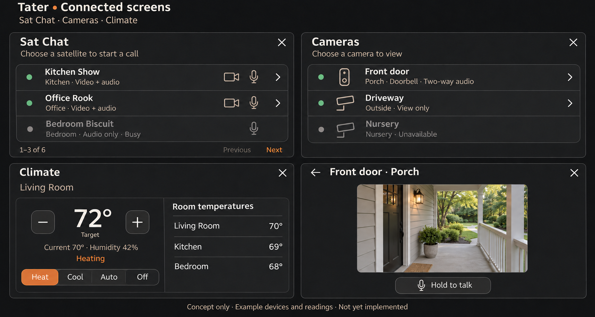

# Connected-screen workspace mockups

Generated with the built-in image-generation tool (not the CLI).
Reference: the approved [workspace concept](satellite-ui-workspace-concept.png).
This board is a design reference, not an installed renderer screenshot. The
approved layouts are implemented and included in the unpublished Checkers
`ui.2` application test, **not pushed or released**. Its normal health trial
passed, as did the operator's menu/full-notification-image and wake/first-word
smoke checks. Video/call qualification remains separate. The prompts/footer
below are retained as the original design record.
The operator subsequently approved landscape camera/call pictures extending
behind floating titles/buttons. That later implementation uses retained GPU
controls on Checkers and cached CPU fallback; the board's reserved-header
spacing is now historical. Rook remains unchanged pending its device work.
See [implementation status and actual renderer previews](../satellite-ui-concept.md#connected-screens-after-design-approval).



## Existing behavior preserved in the proposal

- Sat Chat uses the existing participant name/room, audio/video capabilities
  and busy state. One row starts video when supported, otherwise audio; the
  capability glyphs are not new mode-selection buttons. Existing paging remains.
- The camera directory uses name, room, doorbell/talkback capabilities and
  availability. It has no per-camera thumbnail feed. The detail view retains
  Back/Close and capability-gated hold-to-talk. The generated viewport is
  illustrative, not a pixel-accurate aspect-ratio specification; actual stream
  aspect ratios must be preserved in the renderer, not forced to this grid.
- Climate exposes the existing target/current temperature, humidity, HVAC
  action, bounded setpoint +/- and available Heat/Cool/Auto/Off modes. Other
  room temperatures are read-only, not a new thermostat selector.
- The default Tater charcoal/orange style would follow existing theme accents
  and GPU popup preferences. This board does not claim a new animation or
  video-path qualification. Examples are fictional, not live home readings.

## Initial generation prompt

```text
Use case: ui-mockup.
Asset type: one high-fidelity UI review board, four flat front-facing landscape satellite touchscreen screens in a 2-column by 2-row contact sheet. Each individual screen has the Checkers 960x480 (2:1) proportions. No physical devices, no perspective.
Input image 1 is a STYLE REFERENCE only: the approved Tater workspace UI board. Create a NEW board extending its quiet grey/charcoal visual language to Sat Chat, Cameras and Climate; do not reproduce its home screen or settings screens.
Palette: background #111213, grouped panels #1b1c1e, controls #222426, thin borders #343536, text #f1eee8, secondary #b0a79c, restrained orange #e87b40. No navy or blue-tinted UI panels. Normal-weight readable sans-serif labels, medium-weight headings, generous touch targets and spacing, modest corner radii, muted thin-outline icons. Flat and calm; no glass shine, glowing rims, giant icon badges, or busy decorative gradients. Page titles are simple unboxed words on the background, not a solid header bar. Theme accents could change later; this board shows the default Tater theme.

Board heading above screens: "Tater · Connected screens"
Small subtitle: "Sat Chat · Cameras · Climate"
All names, room labels, readings, status, and camera imagery below are explicitly FICTIONAL EXAMPLES, not actual connected devices.

TOP LEFT SCREEN — Sat Chat directory.
Simple header "Sat Chat", close X at upper right. Muted subtitle "Choose a satellite to start a call".
A single quiet grouped panel with three spacious rows separated by thin dividers, each row a single full-width tap target:
1. "Kitchen Show", secondary "Kitchen · Video + audio", muted outline camera and microphone capability glyphs on the right, restrained available status dot, trailing chevron.
2. "Office Rook", secondary "Office · Video + audio", same glyphs and chevron.
3. "Bedroom Biscuit", secondary "Bedroom · Audio only · Busy", visibly disabled/muted row and no active chevron.
Do NOT draw separate audio-call and video-call buttons. The EXISTING behavior is tapping a row starts video when that peer supports video, otherwise audio. No favorites, history, contacts, search, messaging or recording actions.
Small optional pagination words at bottom "1–3 of 6", "Previous", "Next"; these are directory paging, not a tab bar.

TOP RIGHT SCREEN — Cameras directory.
Simple header "Cameras", close X at upper right. Muted subtitle "Choose a camera to view".
One quiet grouped panel with three generous rows and muted outline camera/doorbell glyphs. NO per-camera photo thumbnails: the existing directory only receives labels/capabilities/availability.
1. "Front door", secondary "Porch · Doorbell · Two-way audio", chevron.
2. "Driveway", secondary "Outside · View only", chevron.
3. "Nursery", secondary "Nursery · Unavailable", disabled/muted row.
No invented recording, detection controls, camera power toggles, snapshot, zoom, or PTZ buttons. Restrained availability indicators only, no fake always-live badge.

BOTTOM LEFT SCREEN — Climate control.
Simple header "Climate", close X at upper right. Below heading "Living Room".
Two balanced sections with a quiet thin divider.
Left: large target "72°", small label "Target", readable line "Current 70° · Humidity 42%", small orange "Heating". Large restrained minus and plus touch buttons flanking the target. Underneath one segmented row "Heat", "Cool", "Auto", "Off", Heat selected with soft orange. These are the currently supported HVAC modes; unavailable modes would be disabled.
Right: heading "Room temperatures", calm read-only rows "Living Room 70°", "Kitchen 69°", "Bedroom 68°", with aligned values. These are readings, not thermostat selection buttons.
No schedule, fan, energy/history chart, thermostat picker or extra controls.

BOTTOM RIGHT SCREEN — Selected camera viewer (existing supported detail state).
Simple header "Front door · Porch", back chevron at upper left and close X upper right. A large tasteful fictional live-view image of a tidy anonymous front porch, no people, private names, street numbers, timestamps or logos. Preserve a 16:9 video image inside the wide 2:1 screen without stretching it. Quiet charcoal surrounding area, very slim border if needed.
A single clear "Hold to talk" microphone control below/beside the view, because this EXAMPLE camera supports talkback; this control would be omitted for view-only cameras. No extra camera actions. Keep the actual picture large and the control unobtrusive.

Outside all four screens, a small clear footer: "Concept only · Example devices and readings · Not yet implemented".
This must look like a cohesive extension of the reference's quiet grouped settings and line icons, not a new unrelated dashboard. Use accurate readable copy and no additional features.
```

## Targeted revision prompt

The initial board made the example camera photo too wide. A second built-in
edit preserves the other panels while requesting a genuine 16:9 example view.

```text
Use case: precise-object-edit. Asset type: satellite UI mockup review board.
Input image 1 is the EDIT TARGET.
Change ONLY the bottom-right selected-camera panel's photo viewport and spacing. Keep the other three panels, all their copy, all headings, typography, palette, page frames, board layout, footer, and UI controls unchanged.
Inside the bottom-right "Front door · Porch" screen, replace the extra-wide cropped photo viewport with a visibly true 16:9 landscape camera viewport, centered horizontally in that screen. Make its displayed width exactly about 1.78 times its height (not 2.5 times). It should be narrower than before, leaving quiet charcoal space at the left and right inside this screen; preserve the photo without stretching. A modestly smaller 16:9 view is intentional so the header and the existing "Hold to talk" button both fit without overlap. Retain a natural anonymous porch scene with no people, addresses, numbers or logos.
Keep the back and close controls above the picture and the one "Hold to talk" control below. No extra controls. Do not change the other screens or invent new data or UI. Keep the board's footer "Concept only · Example devices and readings · Not yet implemented".
```

