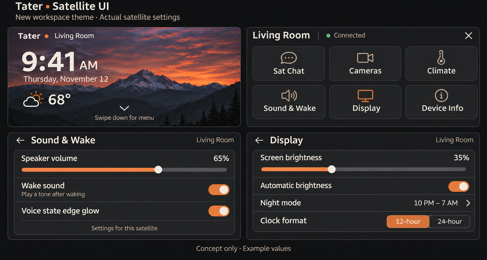
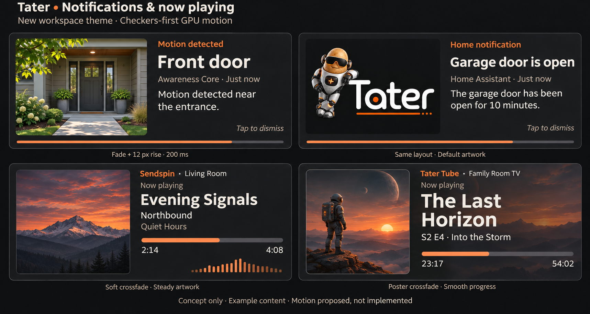

# Satellite workspace UI: design and implementation

The approved workspace is now implemented locally as the shared screen UI.
The image boards below are the original design references, not device photos.
The earlier Checkers `v4.2.3-checkers-ui.1` system passed its health trial/restart
plus the operator's menu/touch/slider and wake/first-word smoke checks. The
subsequent `v4.2.3-checkers-ui.2` application test was installed over that
unchanged good system and passed its real five-minute connected health trial. The
operator also confirmed the new menus, full notification image, and wake with
immediate first-word capture. Nothing has been pushed or published. These are
bounded UI/wake smoke checks, not extended video/call qualification.
The later `ui.3` application passed its real health trial and the operator's
rapid Sat Chat Next/Previous retest. The subsequent local `ui.4` test also
passed its normal health trial in application A. It adds
the operator-requested full-screen landscape video and cached GPU controls,
described below. The operator confirmed the larger picture, readable controls,
and smooth live playback. A peer/codec-specific Sat Chat test was not separately
confirmed; extended call/video qualification remains separate.
The subsequent local `ui.5` refinement adds immediate directory touch/startup
feedback, one-page vertical landscape EQ, and the revised home heading/footer.
It is running in B and the operator approved immediate directory feedback,
the vertical EQ and revised home layout. Its real health trial and detailed
startup timings are tracked in the release-readiness record.
See [the installed-test record](checkers-release-readiness.md#workspace-ui-installed-smoke-test).

### Equalizer presets

The local Equalizer now offers **Flat**, **Warm**, **Voice** and **Manual** on
Checkers, Cronos, Crown, Athena and Rook. Shows have a four-button selector
above all eight vertical faders. Rook has the same selector on both pages,
above four faders that fit the circular panel.

At the owner's request, Warm is the starting curve for devices without saved
EQ. It reproduces the listening curve proposed in
[firmware issue #13](https://github.com/TaterTotterson/Tater-Echo-Firmware/issues/13).
Voice reduces bass and gently lifts the speech bands; Flat sets all bands to
zero. Each named preset disables the separate Presence boost. Selecting Manual
keeps the current sound; changing a slider or Presence boost also selects Manual.

Existing saved EQ remains unchanged and migrates to Manual, including a saved
flat curve or one that happens to match a named preset. `eq_preset` is persisted
with the eight bands and boost flag. The companion Tater controller change
preserves these per-device choices across reconnects and adopts a restored local
curve during hello when the controller has no saved EQ. An existing controller
EQ override remains authoritative during initial connection.

Presets change tone only. Tater retains the existing bass-protection defaults:
Radar/Crown/Athena use -10 dB, and Biscuit/Checkers/Cronos/Rook use -30 dB;
explicit protection overrides and limiter settings are preserved. Warm is also
the firmware's initial EQ fallback on the two screenless Echo targets.

Native production previews:
[Show 5](mockups/eq-presets/show-5-warm.png),
[Show 8](mockups/eq-presets/show-8-warm.png),
[Rook lower bands](mockups/eq-presets/rook-warm-low.png),
[Rook upper bands](mockups/eq-presets/rook-warm-high.png),
[Rook Manual](mockups/eq-presets/rook-manual.png).
Regenerate with `TATER_EQ_PREVIEWS` and `TestEqualizerPresetNativePreviews`.
The controller persistence/migration tests, firmware settings tests, renderer
race suite and ARMv7 renderer build cover this v5.0.1 follow-up. Installation
on the owner's devices and deployment to the running Tater controller are
separate from publication; listening and on-device touch acceptance remain
pending.

### Conversation text style

Display → Appearance & motion → **Conversation text** offers **Smooth** (the
unchanged default slide/fade) and **Matrix**. Matrix reveals on-screen STT and
assistant replies through changing symbols whose characters lock into place in
a shuffled order. It follows the selected theme and preserves typography,
line wrapping, settled words and corrected/final transcript contents.

The setting is saved per satellite. It does not change speech recognition,
wake models, microphone capture, reply generation or audio timing. GPU animation
uses the existing word-quad protocol and a bounded, pre-rasterized variant atlas;
only rectangle selections change during animation ticks. Long revisions reduce
variant count before sacrificing transitions, never visible text. Without the
qualified GPU text path, ordinary readable software text is retained.

The Athena private preview has passed owner visual, wake/first-word and normal
application-health checks; see the Athena release-readiness record. It has not
been pushed as part of a release.

The pending Tater and Home Assistant bridge updates also offer the same choice
in per-satellite Display settings. Updated firmware advertises the
`screen_text_style` capability, so older firmware and non-Echo screens do not
receive an unsupported setting. Both hosts persist accepted touchscreen changes
to that satellite's override. This option is not part of shared voice defaults.

### Home refinements after the installed smoke test

The latest home refinements are included in the unpublished `ui.2` application
test, installed over the unchanged good Checkers `ui.1` system:

- Outline weather symbols match the original mockup rather than the shaded
  PNG art. They are drawn directly by the renderer, with transparent interiors
  over the wallpaper and theme-aware sun/lightning accents.
- Feels like starts the bottom readings strip, followed by supplied/enabled
  room temperature, Room humidity, and other optional Environment readings.
  The duplicated right-hand room temperature/readings group is removed.
  The strip uses the available width and wraps whole readings if crowded.
- The home arrow/message is removed. Only a stationary tap opens the menu;
  swipes/drag releases do not. Existing hold-to-broadcast and slider gestures
  remain supported. Round-screen humidity uses the full words on two lines.

Following operator feedback, the `ui.5` landscape home moves conditions to the
start of that footer, before Feels like. The optional room sensor temperature
moves beside the room name, without a label or a second footer copy. The dot
between the configured assistant first name and room is green when connected
and idle, with distinct mute/offline/voice colors. This is still unboxed text
over the photo, not a top bar. The landscape Equalizer now fits its existing
eight bands and Presence boost on one page with vertical half-decibel faders;
Rook retains its paged round-safe EQ until its own device refinement.
Actual synthetic-data renderer outputs:
[home with sensors](mockups/implemented-checkers-home-extras-v3.png),
[home](mockups/implemented-checkers-home-v3.png),
[equalizer](mockups/implemented-checkers-equalizer-v1.png).

### Connected screens after design approval

The [Sat Chat, Cameras and Climate concepts](mockups/satellite-connected-screens-workspace-v1.md)
are implemented alongside the home refinements above and installed in the
`ui.2` application test on Checkers, which completed its normal health commit.
They have **not** been pushed or published:

- Sat Chat and Cameras use quiet grouped lists with full-row hit targets,
  capability/availability labels and disabled busy/offline rows. Landscape
  pages show three rows; Rook retains its compact round-safe page sizes.
- Climate matches the larger target, bounded +/- controls, segmented supported
  HVAC modes and aligned read-only room temperatures. Existing capabilities,
  setpoint limits and room-reading paging on Rook are preserved.
- Camera detail keeps Back/Close and capability-gated hold-to-talk. Following
  the operator's later approval, landscape video now uses the entire screen
  underneath floating titles/buttons. View-only and talkback share that stable
  viewport. Aspect remains intact without crop/stretch; corners round the
  actual image, not its letterbox. Rook's round-safe video layout is unchanged.
- Sat Chat video now shares that max-fit rounded presentation, rather than
  a fixed 16:9 crop/legacy reduced Crown panel. Its JPEG worker uses contain,
  as does the existing recycled H.264 frame preparation. Its title and End
  Chat now float over landscape video, sharing the cached control mechanism.
  JPEG contain now scales directly into its padded result, saving an image
  allocation and copy, without moving scaling into the UI tick.
- Prepared snapshots, hardware-source fitting and software stream output all
  retain explicit alpha padding. The software fit uses display aspect ratio
  (including non-square samples); it does not guess padding from dark pixels.
  The live viewport/decoder identity stays stable across source-aspect changes,
  and a partial-frame repaint clears old bars while retaining header/controls.
- Checkers uses the existing v3 GPU atlas/quad protocol for floating video
  controls: new pictures upload independently, with no per-frame title/button
  rasterization or atlas upload. A control-only change retains the picture;
  unchanged state submits no job. The 1024×512 control atlas keeps pixel
  coordinates exact in the existing helper's mediump shader. CPU fallback
  blends only cached control rectangles. Mute remains immediately visible
  without covering Close. No helper, driver, or private library changed.
  An explicit owner-device offscreen probe used synthetic pictures, not camera
  captures: both paths reached about 38 FPS, with zero pixels outside an
  8-channel-level CPU/GPU comparison tolerance. This validates composition,
  not end-to-end capture/decode/network or two-peer H.264 performance. The
  existing upload/readback cost remains; this is not zero-copy video.
- Notification artwork now always uses contain, including legacy sender
  `image_fit: cover`/`fill` values. Full landscape/portrait images remain
  visible instead of being cropped, and the default Tater artwork is retained.
  This is a satellite rendering policy; senders need no matching update.

Actual offline renderer previews with **fictional data**, not device photos:
[Sat Chat](mockups/implemented-checkers-sat-chat-v1.png),
[Cameras](mockups/implemented-checkers-cameras-v1.png),
[Climate](mockups/implemented-checkers-climate-v1.png),
[camera with talkback](mockups/implemented-checkers-camera-view-v2.png), and
[view-only camera](mockups/implemented-checkers-camera-view-only-v2.png), plus
[Sat Chat video](mockups/implemented-checkers-sat-chat-video-v2.png).
The camera/call fixture is a bundled landscape, not a live home feed.

Validation includes the renderer/internal/package regression suite, renderer
and video-stream race tests, ARMv7 renderer compile, and offline previews for
Checkers/Crown/Rook. Synthetic MP4s were also decoded with the bundled ARM
FFmpeg 8.1.2 under emulation: 16:9, 4:3, portrait and anamorphic inputs retained
their display proportions and transparent bars. This is a decoder/filter
compatibility check, not a live camera, performance or GPU device test.

## Implementation and validation

### Approved popup refresh (local source, not installed)

Checkers/Cronos (960×480) and Crown/Athena (1280×800) now share the approved
notification, video controls, linked-player companion and waiting-screen style.
Notification images use the entire screen with a contained foreground and a dim
cover copy behind letterboxing. A static top/bottom shade keeps text readable;
no image is stretched or cropped out of the foreground, and missing artwork
still selects the Tater logo. Source/category labels, dismissal, critical-event
priority and expiry behavior are retained.

The standalone video player now uses the same qualified GPU picture/atlas path
as live views, with cached pause/loading/error controls over an aspect-correct
picture. Control opacity changes through small quad commands; a new decoded
picture does not rerasterize the controls, and a metadata/mute change does not
reupload the picture. Controls disappear during ordinary playback. Stop remains
available during loading/errors, and existing pause/resume/stop commands are
unchanged. Older GPU helpers and disabled/failed GPU sessions retain the safe
software renderer. Camera/Sat Chat capture, codecs and transport are untouched.

The waiting indicator is three cached, anti-aliased breathing dots in the active
theme's primary accent. A reserved 48-pixel strip shares the conversation's
existing atlas; the Matrix packer reserves room before reaching the 1024-high
protocol limit. Three quads are reserved without sacrificing current text.
Animation uses elapsed time, not a queue of frame steps; ordinary ticks upload
neither text nor sprite pixels. Software fallback reuses the same cached sprite
tiles. Listening/reply streaming remains unchanged; final thinking/working text
centers smoothly and stays clear of the dots. Rook keeps its previous layout.

Native synthetic examples (layout previews, not device photos or GPU timing
measurements): [Show 5 notification](mockups/popup-refresh/checkers-notification.png),
[Show 8 notification](mockups/popup-refresh/crown-notification.png),
[video controls](mockups/popup-refresh/crown-video-paused.png),
[linked-player companion](mockups/popup-refresh/crown-now-playing.png) and
[thinking](mockups/popup-refresh/crown-thinking.png).
Regenerate with `TATER_POPUP_PREVIEW_DIR` and `TestPopupRefreshOfflinePreviews`.
Unit/race tests and the ARMv7 renderer tests cover all four Show targets;
operator checks of actual motion, visibility and video playback remain pending.
Nothing was installed, pushed, tagged or version-bumped for this source change.

### Existing workspace implementation

- Shared charcoal workspace, six-tile menu, unboxed home text, and preserved
  Tater/Ocean/Violet/Forest/Sunset accent themes. Tater's new default primary
  is `#e87b40`.
- Working local Sound & Wake, Display, Appearance & Motion, Night, DND, EQ,
  and read-only Device Info pages. The EQ labels follow the actual eight
  speaker bands (125/250/500 Hz, 1/2/3.5/5.5/8 kHz).
- Following the installed UI review, Sound & Wake is limited to speaker
  volume, voice-state edge glow, and direct links to Equalizer and DND.
  Wake sounds, Continued Chat, and Interrupt Replies remain controlled by
  Tater/the connected host, not the local menu. They are also excluded from
  local preference writes/restoration, including files from the older menu.
  Presence boost stays under Equalizer: the existing speaker-output filter
  adds a 5 dB peak at 2.5 kHz (Q 0.8), not microphone or wake processing.
  This menu cleanup is local source work, not installed on Checkers yet.
- A bounded loopback `screen.settings.set` request reaches the daemon's
  existing settings hook and reports changes with `settings.changed`.
  Unsupported keys, credentials, model URLs, AEC and speaker-protection
  overrides are rejected before local side effects.
- Safe preferences persist atomically in
  `/data/local/etc/tater/screen-settings.json`. Existing mixer-volume storage
  remains authoritative; a cached volume is not restored over later physical
  button changes. Host-managed custom wake URLs are not copied into this file.
- Checkers v3 retained GPU scenes cover menu/settings navigation, directories,
  notifications, Sendspin, and the media companion. Fade is the default;
  Slide and Off are available under Display → Appearance & Motion. Slide uses
  the existing retained atlas/quad protocol, not a new proprietary helper.
  Unsupported runtimes fall back to the existing software renderer; they do
  not claim animated 3D effects or unqualified GPU support.
- Dynamic progress, time labels, and the spectrum use one bounded 1024×128
  atlas and small quad updates; stable artwork is not uploaded every frame.
  Periodic progress/lease updates do not restart entrances. Safety-critical
  notifications and mute changes do not wait for decorative fades.
- Offline renderer previews and unit/regression/race checks have been run.
  Checkers' installed GPU/input/wake smoke checks and normal automatic health
  commit/restart passed on the UI test build. **Extended-load/media/thermal
  qualification remains required before release.** Other targets retain
  software presentation and need their own hardware refinement/qualification.

Offline previews can be regenerated without a satellite by setting
`TATER_WORKSPACE_PREVIEW_DIR` and running `TestWorkspaceOfflinePreviews`.
They use explicitly fictional sample metadata and local bundled artwork.

### Rendered implementation previews

These are actual software-renderer outputs from the current Go implementation,
not AI concept images or installed-device captures:

- [Refined home](mockups/implemented-checkers-home-v2.png)
- [Refined home with optional readings](mockups/implemented-checkers-home-extras-v2.png)
- [Six-tile menu](mockups/implemented-checkers-menu.png)
- [Sound settings](mockups/implemented-checkers-sound.png)
- [Display settings](mockups/implemented-checkers-display.png)
- [Notification](mockups/implemented-checkers-notification.png)
- [Music](mockups/implemented-checkers-music.png)
- [Media companion](mockups/implemented-checkers-tube.png)

Verification covers the internal/package regression suite, renderer tests,
daemon tests in the pinned builder, race checks for screen/native/GPU/renderer
packages, and ARMv7 compilation of the daemon and renderer. The daemon compile
check does not include the release ONNX build tag and is not a release artifact.
Software previews also cover Crown and Rook dimensions; none of these checks
establish installed GPU timing, touch calibration, or hardware qualification
by themselves. The separate Checkers operator smoke test is bounded evidence,
not a complete hardware-release qualification.

## Style source

The palette follows the current local Tater main-app UI work in
`frontend/src/workspace.css` and the quieter grouped forms in
`frontend/src/settings/settings.css` in the separate Tater repository. Its
`frontend/src/entry.ts` loads `workspace.css` after `base.css`, so the workspace
tokens below override the older base theme. The initial concept used the base
tokens; the current revision corrects that mismatch. The main app was inspected
read-only. Do not copy desktop-sized navigation or dense forms onto a small
touchscreen.



| Role | Main-app color |
| --- | --- |
| Background / soft background | `#111213` / `#171819` |
| Cards / controls | `#1b1c1e` / `#222426` |
| Border | `#343536` |
| Text / secondary text | `#f1eee8` / `#b0a79c` |
| Orange / softer orange | `#e87b40` / `#ee8954` |

Use flat charcoal surfaces, thin borders, normal-weight labels, medium-weight
headings, large touch targets, and restrained orange emphasis. Group settings
inside a single quiet panel with row dividers instead of separate floating
pill cards. Inactive navigation icons use muted grey rather than bright orange.

The home screen has **no top bar**: its wallpaper extends to the upper edge.
Only the Tater and room words sit directly on the scenery, without a background
strip, connection badge, or Wi-Fi chrome. Keep the clock, date and weather, but
remove the historical concept board's arrow/menu hint; opening is tap-only.
Avoid navy or blue-tinted menu panels. The concept board
contains example values, not current device readings or new defaults.

## Real controls behind the mockup

Checked against firmware `device/cmd/server.go`,
`device/internal/taternative/player.go`, target capabilities in
`device/internal/taternative/client.go`, and the main app's
`tater_voice/native_live_settings.py`.

| Proposed on-device control | Existing wire setting | Behavior |
| --- | --- | --- |
| Speaker volume | `volume_percent` | 0–100 percent |
| Wake sound | `wake_sound_enabled`, `wake_sound` | Enable/disable a valid selected built-in or cached custom sound |
| Voice state edge glow | `display_edge_glow` | Screen voice-state effect, not a physical LED ring |
| Screen brightness | `screen_brightness` | 0–100 percent; zero turns off the backlight |
| Automatic brightness | `screen_auto_brightness_enabled` | Screen brightness remains the maximum |
| Automatic minimum (detail page) | `screen_auto_brightness_minimum` | 1–50 percent of the selected brightness |
| Night mode | `screen_night_mode_enabled` | Enable a daily local-time schedule |
| Night start / end | `screen_night_start`, `screen_night_end` | Existing HH:MM format; overnight schedules supported |
| Night appearance (detail page) | `screen_night_display` | `red_clock`, `dim`, or `off` |
| Night brightness (detail page) | `screen_night_brightness` | 0–100 percent |
| Clock format | `screen_clock_format` | `12h` or `24h` |
| Color theme (appearance page) | `display_theme` | Existing firmware-supported display themes |
| Photo rotation (appearance page) | `display_wallpaper_interval_minutes` | Fixed, hourly, 6-hourly, 12-hourly, or daily |
| Uploaded photos | `display_wallpaper_urls` | Existing uploaded-photo flow; not a new local file browser |

Sat Chat, Cameras, and Climate retain their existing on-device actions.
Sound & Wake, Display, and Device Info are now additional working menu pages.

### Device differences and implementation requirements

- Checkers, Cronos, Crown, Athena, and Rook advertise screen settings, **not**
  Biscuit/Radar's physical LED ring. Do not put `led_listening_animation` or
  a generic “Voice ring” control on a screen satellite.
- Ring-specific settings belong only to targets that advertise that hardware.
  Display, ambient-light, and clock controls must follow advertised capabilities.
- Rook uses a round-safe six-tile menu and paged settings. Its physical layout
  and GPU qualification still need separate review; a landscape board is not
  evidence of hardware qualification.
- Keep wake-model selection and advanced model tuning in Tater/the bridge for
  now. The everyday device menu should not expose threshold or sliding-window
  sliders just because those settings exist.
- Device Info should be read-only and display available firmware/connection/
  runtime diagnostics. Never hardcode “GPU active” or “hardware video active”
  from a device model or show invented live readings.
- Local controls use the existing settings/reporting path and validated safe
  deltas. Ordinary display changes do not reset wake detection or reconfigure
  AEC. Physical testing and host round-trip validation remain release gates.
- A wake-sound toggle must preserve/select a valid sound, not merely set
  `wake_sound_enabled=true` while `wake_sound=no_sound`.
- Short transitions should yield immediately to voice, calls, and privacy state.

## Wallpaper additions

The existing seven scenes remain in the catalog; `alpine-sunset`,
`misty-lake`, and `desert-dusk` are appended. Both native families are
included: Checkers/Cronos 960×480 and Crown/Athena 1280×800. Rook uses the
existing centered cover preparation from the Crown family.

The sunset is a newly generated standalone recreation of the mockup's scenery,
not a screenshot with interface text cropped away. Generated with the built-in
image tool; final native JPEG assets and exact prompts are recorded in
[the wallpaper asset notes](../device/cmd/tater-show-linux/assets/wallpapers/README.md).

Only the active scene is decoded/cached as before. Rotation timing and uploaded
photo precedence are unchanged. Adding scenes changes the catalog's modulo
cycle; it does not reset or alter a user's configured rotation interval.

## Notifications, music, and media companion design



These are static design references for the local implementation, not captured
GPU animation frames. The same effective main-app workspace theme applies: neutral charcoal,
warm text, muted labels, soft orange emphasis, and no solid top bar. Example
content is illustrative, not actual home/camera/playback state.

### Existing fields retained

- Notifications: category/label, title or camera name, source, creation time,
  description, optional image, and expiry progress when an expiry exists.
  Preserve the Tater artwork fallback with contain sizing rather than cropping
  the mascot/wordmark. Tap dismissal remains a local display interaction; no
  unsupported camera action buttons are proposed.
- Sendspin: square artwork, title, artist/album artist, album, group, playback
  state, elapsed/total time, and available audio-reactive spectrum. Hide absent
  metadata and duration-dependent progress rather than inventing values.
- Media companion: poster plus dimmed full-screen poster backdrop, player name,
  series/title, season/episode, episode title/subtitle, playing/paused state,
  elapsed/total time. Keep it display-only: no new play/pause/seek controls.

The fields were checked in `device/internal/show/server.go` and their current
layouts in `device/cmd/tater-show-linux/main.go`. The board does not add a new
sender API or require its example notification sources to be built into Tater.

### Motion design and implementation boundary

The table records the approved motion goals. The implemented default is the
shared 220 ms GPU fade; optional Slide currently applies to menu/settings and
directory navigation. Per-widget rise/exit refinements remain hardware-tuning
work, not a claim made by these concept images.

| Event | Proposed behavior |
| --- | --- |
| New notification | About 200 ms opacity fade with a small 12 px upward settle |
| Dismissal / expiry | Short fade out, respecting current screen selection and event priority |
| Song or media item changes | Roughly 200–250 ms art/text crossfade, not a zoom or sliding poster |
| Progress / spectrum | Smooth incremental updates without replaying the entrance |
| Same-item metadata refresh | Update only affected content; retain artwork and transition identity |
| Voice, calls, timers, privacy or critical state | Remain responsive; do not wait for a decorative animation |

Checkers' `gpuSurface` in `gpu_scene.go` now includes notifications, active music,
and media companion in the retained-scene path. Timers, active calls, video,
privacy-sensitive states and unavailable GPU runtimes retain their established
safe presentation routes. The default popup is a quiet fade; the illustrated
notification rise is an optional Slide-style direction rather than a mandatory
movement on every notification.

The implementation reuses retained artwork/text textures with bounded caches
and uploads them only when visible content/artwork identity changes.
Progress/spectrum use the existing v3 atlas/quad protocol without changing the
helper ABI. Periodic progress snapshots do not redownload artwork or restart
entrances. Paused spectrum levels stay at a quiet baseline. Privacy,
critical-alert colors, existing audio behavior, expiry handling, and software
fallback remain in place.

GPU effects are Checkers-first until the other targets are qualified. Rook needs
a separate round-layout review, not a cropped copy of this landscape board.
These static mockups do not establish a frame-rate or thermal qualification.

### Generation prompt

Built-in image generator. Inputs: the approved workspace-style UI concept board
as the style/layout reference and the repository's Tater logo as the default
notification artwork reference.

```text
Use case: ui-mockup. Asset type: polished high-fidelity satellite touchscreen concept board.
Input image 1 is the approved Tater satellite workspace mockup: preserve its overall 2x2 board presentation and visual styling, but REPLACE all four interior screen contents with the notification/music/media designs described below. Input image 2 is the EXACT Tater brand artwork to use as the notification's default/fallback image: preserve its mascot and white Tater logo identity, do not invent a different mascot.
Primary request: extend the approved main Tater app-inspired satellite style to notifications, Sendspin music and media companion now-playing. Four flat front-facing landscape screens, no physical devices, no perspective. Each screen is 2:1 (Checkers logical 960x480), arranged in 2 columns and 2 rows, enough breathing room for clear large type. Overall high resolution readable contact sheet. Board-only captions outside screens can annotate proposed motion; do NOT show arrows/animation states ghosted inside actual UI.
Palette and typography: charcoal background #111213, panels #1b1c1e, controls #222426, thin separators #343536, warm-white text #f1eee8, muted grey #b0a79c, restrained softened burnt-peach orange #e87b40/#ee8954. Normal humanist sans like Aptos/Segoe UI, medium-weight 500 headings and regular 400 secondary text. Flat quiet surfaces and modest 12px corners. No navy or blue-tinted UI, no glowing outlines, no heavy shiny gradients, no all-caps shouting. Large readable main titles; restrained labels.
Global rule: NO solid top bar or application chrome on any screen. Source labels are simple words directly on their background. No giant blank status header. No play/pause/previous/next/seek buttons, action buttons or toggles: these mockups use the fields the screens actually receive, not invented remote controls.

Panel 01 top-left, caption outside "Notification · supplied image":
A tasteful full-screen notification, charcoal rather than navy. Large landscape camera snapshot on the left in a flat rectangular frame, showing a tidy anonymous house entrance and front walkway in daylight, no private addresses/numbers. Text area to the right: small orange category "Motion detected"; large main title "Front door"; muted source/time "Awareness Core · Just now"; body "Motion detected near the entrance." Small subtle lower-right "Tap to dismiss". A very thin orange time-to-dismiss line near bottom. No invented camera-view/action buttons. Balanced about half image and half text, readable. Keep source/category/title/body hierarchy clear.

Panel 02 top-right, caption outside "Notification · default Tater image":
The exact SAME notification layout, but no supplied camera image. Left frame uses the Tater artwork from input image 2, mascot plus full white Tater wordmark on its dark backdrop, centered and fully CONTAINED with padding, not zoomed/cropped. On right small orange category "Home notification", large title "Garage door is open", muted source/time "Home Assistant · Just now", body "The garage door has been open for 10 minutes." Small "Tap to dismiss" at bottom, thin orange expiry line. Important: source can be any compatible sender, no new product logo or app-specific controls.

Panel 03 bottom-left, caption outside "Sendspin · music":
Large square album art on the left: original fictional artwork of a quiet mountain ridge and warm copper dusk sky, subtle and beautiful, no album text on the art. Right content: small orange "Sendspin · Living Room"; small muted "Now playing"; large main song title "Evening Signals"; artist "Northbound"; muted album "Quiet Hours". Thin orange progress bar at 54% across right content, with left elapsed "2:14" and right duration "4:08". Along lower right a short restrained row of orange/charcoal audio spectrum bars, representing actual audio-reactive movement; no giant neon visualizer. Neutral charcoal base, artwork remains steady. No remote playback buttons, no progress scrubber handle. No top bar. Do not put metadata on tiny unreadable lines.

Panel 04 bottom-right, caption outside "Media companion · now playing":
Preserve the beloved cinematic poster-background design. Entire screen background is a cinematic ORIGINAL sci-fi landscape of a lone astronaut on a mountain ridge looking toward an orange sunset and distant planets, dimmed with a NEUTRAL CHARCOAL veil so it harmonizes with the other screens (not navy). A tall portrait crop of that same artwork on the left, modest round corners. Right side simple small orange source words "Tater Tube · Family Room TV", small muted state "Now playing", very large readable title "The Last Horizon" (can wrap to 2 lines), secondary line "S2 E4 · Into the Storm". Lower-right orange progress track filled 43%, elapsed "23:17" left and total "54:02" right. No play/pause/seek controls: satellite only displays the linked player's state. Full-bleed dim artwork still visible behind the text; no card covering all the background. No top bar.

Outside the screens: top heading "Tater · Notifications & now playing"; subtitle "New workspace theme · Checkers-first GPU motion". Under panels 01 and 02 respectively tiny captions "Fade + 12 px rise · 200 ms" and "Same layout · Default artwork". Under panels 03 and 04 tiny captions "Soft crossfade · Steady artwork" and "Poster crossfade · Smooth progress". Small bottom footer "Concept only · Example content · Motion proposed, not implemented".
The visual should feel like one coherent product family matching the approved reference while retaining useful imagery and readable content. No home screen clock/menu/settings controls anywhere on this board. No extra text or new features.
```


## Mockup generation record

Built-in image tool, preview-only output; not a production renderer screenshot.

### Initial charcoal-board prompt

```text
Use case: ui-mockup. Edit target: the supplied Tater Checkers UI concept board. Preserve the design direction the user liked: calm mountain sunset home, orange thin-line icons, 3-by-2 menu tile grid, large touch-friendly text, restrained professional layout. Create a polished updated 2-by-2 contact sheet with four landscape touchscreen panels each EXACTLY 2:1 aspect ratio, native logical size 960x480. Overall board landscape, high resolution, sharp readable labels. Do not show physical device bezels or perspective.
Primary changes:
1. Match the actual main Tater app palette: page background #111213, header #151617, cards #1a1b1d, controls #202225, borders #2a2c30, primary text #f1eee8, muted labels #a8a096, orange accents #d65a1f and #f08345. Neutral charcoal-grey UI surfaces with absolutely NO navy, blue sheen, blue gradients, or glassmorphism. Flat quiet panels with thin borders, 12px rounded corners. Normal medium-weight humanist sans-serif like Aptos/Segoe UI. Keep orange restricted to icons, active controls and small emphasis, like the main desktop Tater app. Bigger touch targets and spacing for small satellite screens.
2. Base every displayed control on existing satellite settings, not speculative features. Example values, not a report of live device state.
Four panels:
01 Quiet home: same snowy mountain and dark pine sunset scenery as reference, subdued enough behind warm-white text. Header "Tater" with small orange dot and "Living Room"; status small connected dot and Wi-Fi icon. Large "9:41" plus "AM"; below "Thursday, November 12"; weather partly cloudy icon and "68°". Bottom small down-chevron and "Swipe down for menu". Natural scene colors allowed; UI overlays neutral.
02 Main menu: header "Living Room" with small connected indicator and close X. Grid six simple dark-grey cards in two rows of three with orange thin-line icons and labels exactly "Sat Chat", "Cameras", "Climate", "Sound & Wake", "Display", "Device Info".
03 Sound & Wake: back arrow, heading "Sound & Wake", small room name. Three quiet grouped setting rows. "Speaker volume" and "65%" with wide orange slider; "Wake sound" and orange On toggle, helper "Play a tone after waking"; "Listening animation" and selected "Voice ring" with chevron. Small footer "Settings for this satellite". Do not claim one generic voice lighting setting; listening animation is a real setting.
04 Display: back arrow, heading "Display", small room name. Four roomy rows: "Screen brightness" with "35%" and orange slider; "Automatic brightness" with orange On toggle; "Night mode" with "10 PM – 7 AM" and chevron; "Clock format" with compact segmented "12-hour" selected in muted orange and "24-hour" unselected. Keep all legible and uncluttered.
Outside panels, understated board heading "Tater · Satellite UI" and subtitle "Main app styling · Actual satellite settings". Tiny bottom footer "Concept only · Example values". No other copy. Important: The image should feel charcoal GREY, warmer and quieter than the original blue board. Preserve the mountain sunset design and overall simple satellite identity; do not copy the desktop's dense sidebars.
```

### Final capability correction

The initial board showed a ring-only listening animation. The final edit removes
that control in favor of the existing screen voice-state edge glow setting.

```text
Use case: ui-mockup. Edit target: the supplied neutral charcoal Tater satellite concept board. Make exactly ONE local correction: in the lower-left Sound & Wake screen, replace the entire last setting row that currently says "Listening animation" and "Voice ring" with a row labelled exactly "Voice state edge glow" and a simple orange ON toggle on the right. Remove the Voice ring text and its chevron. This is the actual screen-satellite setting; do not show LED-ring animation controls on a Checkers screen satellite. Preserve EVERYTHING else: all four screen layouts, actual text, neutral charcoal-grey surfaces, main-app warm-white typography, orange accents, mountain sunset, main menu, screen brightness and automatic brightness and night mode and clock format controls. No navy or blue UI tint. Maintain sharp legible text.
```

## Current revision: effective workspace theme and unboxed home

Built-in image-tool edit after checking the separate main-app repository's
stylesheet import order, workspace token overrides, shared form rows, icons,
and focused settings workspace. The earlier prompts above are retained only
as design history, not the current color specification.

```text
Use case: ui-mockup. Edit target: the supplied Tater satellite concept board. Revise this existing 2x2 board to follow the NEW main Tater application's actual workspace design, not its older base theme. Keep a front-on, sharp, high-fidelity flat UI concept board, with four landscape satellite screens and all the same real controls and example values. Concept only, not a screenshot of running firmware.
Verified style source: separate Tater repo frontend/src/entry.ts imports base.css first and workspace.css afterward. workspace.css overrides the theme. Use these NEW effective colors: page #111213, soft background #171819, card #1b1c1e, control #222426, additional surface #292b2d, text #f1eee8, muted text #b0a79c, thin dividers #343536, soft burnt-peach orange #e87b40 with #ee8954 highlights, restrained success green #82c9a0. Do NOT use the previous highly saturated bright orange. Typography humanist sans like Aptos/Segoe UI: normal body weight 400, headings 500, NOT chunky heavy bold. Calm grey utilitarian workspace, understated 1.6px stroke line icons, no glassmorphism, gradients, shadows, 3D, blue tint or glowing cards. Keep large enough for a satellite touchscreen.

CRITICAL HOME CHANGE (top-left panel):
Remove the entire dark top bar/rectangle/background strip, its separator line and all status-chrome treatment. The mountain sunset wallpaper must extend completely to the very top of the home screen with NO solid header band. Retain just simple unboxed words "Tater" with a small orange dot, and "Living Room" alongside, placed directly ON the wallpaper near the upper-left, as in the earlier original quiet-home idea. No Wi-Fi icon or connection badge on the home screen. Preserve the large "9:41 AM", "Thursday, November 12", partly-cloudy weather "68°", and small bottom chevron plus "Swipe down for menu". Preserve the mountain sunset scenery and clock/weather composition. The words are text over scenery, never inside a top bar, pill, card or tinted panel.

MAIN MENU (top-right):
Keep the six touch targets in the existing 3x2 grid: "Sat Chat", "Cameras", "Climate", "Sound & Wake", "Display", "Device Info". Heading "Living Room", small connected status, X close. Use flat dark-grey cards, thin #343536 borders, modest 10-12px corner radius, medium-weight text. Most line icons should be muted warm grey like the new app navigation, not all orange. Orange reserved for active controls/emphasis, not giant bright pictograms. No gradient or glossy panels.

SOUND & WAKE (bottom-left):
Back arrow, medium-weight heading "Sound & Wake", room "Living Room". Replace the three separate pill-like floating row cards with ONE quiet rectangular grouped-settings card with modest corner radius, thin border and subtle horizontal divider lines between rows, matching main app workspace form rows. Contents remain exactly:
"Speaker volume" and "65%" with slider filled 65 percent, solid soft burnt-peach orange.
"Wake sound" with On toggle and helper "Play a tone after waking".
"Voice state edge glow" with On toggle.
Footer small muted "Settings for this satellite".
The edge glow is a real screen setting; NO LED ring or listening animation selector.

DISPLAY (bottom-right):
Back arrow, medium-weight heading "Display", room "Living Room". ONE flat grouped settings panel with subtle row dividers, not four floating pill cards.
"Screen brightness" and "35%" with slider filled 35 percent.
"Automatic brightness" On toggle.
"Night mode" and "10 PM – 7 AM" with chevron.
"Clock format" with "12-hour" selected and "24-hour" unselected in a compact simple segmented control.
Use the newer muted orange only on active controls. All labels readable, text weight not heavy.

Board title "Tater · Satellite UI"; small subtitle "New workspace theme · Actual satellite settings"; footer "Concept only · Example values". Do not add any other features or text. Key changes must be visually evident: home wallpaper has NO TOP BAR, all menus are calmer FLAT GREY, softened peach/burnt-orange accents, lighter type, and grouped forms from the new main app.
```


